# Manual ilustrado para iniciantes

**[v0.1.2: abrir o PDF de 43 paginas](../guia-ilustrado-iniciantes.pdf)**. Este manual e gerado da mesma fonte do PDF, com a mesma sequencia e conferencias.

**Hardware e ativacao ainda nao testados.** Sao diagramas propostos, nao fotos da montagem real. Motores e LiPo nao estao liberados para montagem energizada.

## 1. Antes de comecar: o que este guia prova

Este e o manual visual da montagem ELETRICA INICIAL: protoboard, OLED, amplificador e falante. O firmware compilou; nao tenho as pecas em bancada e nao posso comprovar seu funcionamento fisico a distancia.

Os desenhos sao originais, explicativos e nao fotografias das suas pecas. As coordenadas foram escolhidas para distribuir os sinais em uma protoboard comum A-J. Precisam coincidir com as letras/numeros e a continuidade da unidade real.

A XIAO e os modulos ficarao FORA da protoboard, sobre suporte nao condutivo. So os fios entram nos furos indicados. Isso evita inventar a posicao de encaixe da placa ou esconder furos debaixo dela.

Motores: apenas planejamento neste PDF, nao ligacao energizada. LiPo: desconectada em todas as etapas. O guia de execucao de 16 paginas registra a proposta tecnica anterior. Para a sequencia inicial de montagem e Windows, usar este manual atualizado.

Se sua placa ou os nomes dos pinos diferirem, pare. Nao escolha um pino por parecer estar na posicao do desenho.

**Conferencia:** Pode seguir: leitura e preparacao sem energia. Nao pode: energizar pecas que nao foram conferidas.

## 2. Roteiro: uma etapa por vez

COMO USAR: acompanhem a sequencia do PDF, sem saltar etapas. O indice lateral do leitor de PDF permite voltar a um assunto. As caixas CONFERENCIA dizem o que deve estar certo antes de avancar.

ETAPA A - Sem energia: conhecer a protoboard, conferir conectores e preparar headers. Se faltam cabos ou uma solda segura, parar aqui. O ferro de solda pode causar queimaduras; nao e uma atividade para fazer sem supervisao e preparo.

ETAPA B - Sem energia: montar OLED, depois audio, mantendo todos os fios anteriores. Comparar com as duas figuras de conjunto completo.

ETAPA C - Computador Windows: extrair arquivos, preparar Python, descobrir a porta e gravar. Um comando por vez; nao copiar o 'PS C:\robot>' de exemplos.

ETAPA D - Energia USB: ler logs e conferir display/camera. So depois configurar rede e conta. Se surgir erro, registrar o primeiro e parar.

ETAPA E - Motores: permanece bloqueada ate identificar fonte, conectores e servos reais. Nao usar a LiPo. Nao interpretar o diagrama de alimentacao como autorizacao de montagem.

Nao estimamos tempo de montagem. Uma etapa pode terminar em 'falta uma peca' ou 'precisa de ajuda presencial'. Isso e um resultado correto, nao motivo para improvisar.

**Conferencia:** Os resultados esperados sao criterios a testar, nao resultados ja observados nas suas pecas.

## 3. Aprender o mapa dos furos

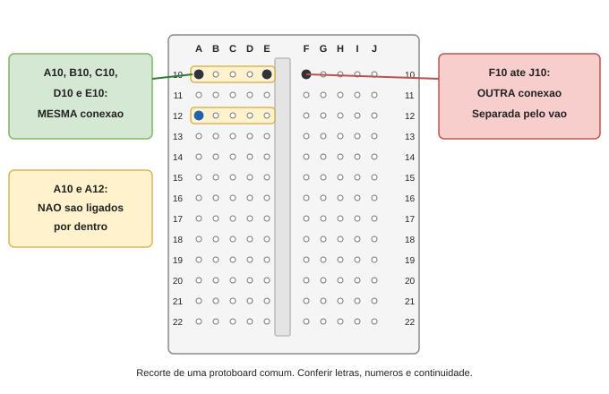

Segure a protoboard com as letras A-J legiveis. Numero = linha; letra = coluna. A10 significa o furo da coluna A, linha 10. Neste recorte mostramos somente 10 a 22.

A10-B10-C10-D10-E10 sao uma unica conexao interna. F10-G10-H10-I10-J10 formam OUTRA conexao. O vao no meio separa os dois grupos.

A10 NAO e ligado a A11. Para unir linhas diferentes seria preciso um fio; neste layout nao faremos isso.

**Conferencia:** Aponte A10, E10, F10 e A11 antes de continuar.

## 4. Entender os barramentos laterais

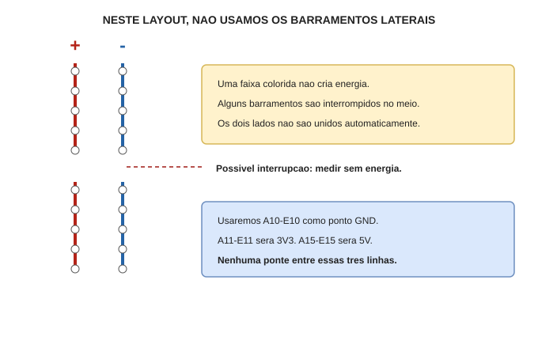

As faixas compridas marcadas + e - sao chamadas barramentos. Elas nao geram eletricidade. Podem ter interrupcao no meio e os lados esquerdo/direito podem ser independentes.

Para reduzir as chances de erro, este manual NAO usa os barramentos. Vamos usar somente as tiras A-E de cada linha numerada. Nao acrescente pontes nas faixas + e -.

**Conferencia:** Deixe todas as faixas laterais sem fios.

## 5. Praticar continuidade, sem energia


Use uma protoboard VAZIA, sem placa, USB, bateria ou fontes. No multimetro, ponta preta em COM; vermelha no borne V/ohm conforme o manual. Nao usar a entrada de corrente A/mA.

1. Selecione continuidade. Encoste uma ponta na outra para conhecer o sinal do aparelho.
2. Teste A10 e E10: devem estar ligados.
3. Teste A10 e F10: devem estar separados.
4. Teste A10 e A11: devem estar separados.

Se as pontas nao entrarem, usar dois jumpers macho como extensoes, sem forcar o furo. Teste com cuidado para as pontas nao encostarem entre si.

Se os resultados forem diferentes, nao use as coordenadas deste manual ate entender sua protoboard. Nao remova a base adesiva para abrir a peca.

**Conferencia:** Na protoboard vazia: A10-E10 ligado; A10-F10 e A10-A11 separados.

## 6. Evitar o erro que causa curto

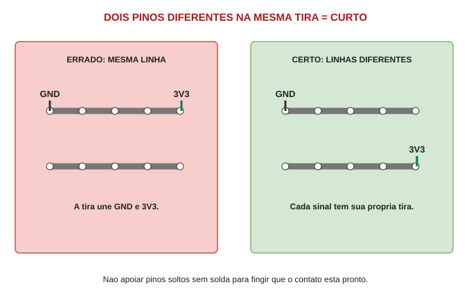

Dois pinos diferentes nao podem cair na mesma tira interna por acidente. Por exemplo: GND em A10 e 3V3 em E10 ficam unidos e causam curto quando houver energia.

Nao force as duas fileiras de uma placa sobre uma regiao sem conhecer quais furos ficam ligados. Neste manual a placa fica fora da protoboard e cada pino e levado por um fio ao seu ponto.

**Conferencia:** GND na linha 10; 3V3 na 11; 5V na 15. Nunca unir essas linhas.

## 7. Pecas, conectores e fios certos

Separar: XIAO ESP32-S3 SENSE com expansao de camera/microfone; OLED SH1106; um MAX98357; um falante 4 ohms/3 W; protoboard A-J; multimetro; cabo USB de dados.

Para esta montagem fora da protoboard, voce precisa de jumpers FEMEA-MACHO: o lado femea encaixa no pino macho ja soldado do modulo; o lado macho entra na protoboard. Confira seu pacote: ter jumpers nao garante que ele inclua esse tipo.

Se uma peca tiver somente furos sem pinos soldados, ela ainda nao esta pronta para receber o jumper. Um header encostado sem solda NAO e conexao confiavel. Nao usar a XIAO como primeira pratica de solda. Pedir ajuda presencial para soldar e inspecionar, ou obter conectores ja montados.

Fixar placas em suporte nao condutivo sem tapar microfone, lente ou antena. Nao apoiar pinos sobre metal, parafusos ou fios soltos.

Cores ajudam a organizar, mas nao definem a funcao. Etiquetar as duas pontas de cada fio pelo nome do sinal.

**Conferencia:** Se faltar jumper femea-macho ou header soldado, parar a montagem eletrica nessa peca.

## 8. Checklist de materiais antes da montagem

NUCLEO: uma XIAO ESP32-S3 SENSE com expansao e antena; um OLED SH1106; um MAX98357; um falante 4 ohms/3 W; uma protoboard A-J com pelo menos 22 linhas.

LIGACOES: 17 jumpers femea-macho para OLED e amplificador, mais dois fios adequados para o falante. O botao opcional usa mais tres ligacoes. Separe alguns jumpers macho-macho para testar continuidade.

FERRAMENTAS: multimetro com continuidade; cabo USB-C de DADOS; computador Windows com internet; suporte nao condutivo; etiquetas; descascador de fio apropriado; pequena chave se houver bornes.

SE FALTAM HEADERS: barras macho 2,54 mm compativeis, solda eletronica apropriada, ferro em suporte, ventilacao/extracao, protecao ocular e placa de treino. O kit de solda comprado nao garante que todos os consumiveis e cabos estejam presentes.

Nao comprar a fonte dos motores como substituto de um item faltante no nucleo. A montagem de motores sera tratada separadamente.

Marque na lista: tenho / falta / nao sei identificar. Se marcar 'nao sei', fotografe a peca desligada e resolva a identificacao antes de conectar.

**Conferencia:** Conte 17 cabos femea-macho e confira headers firmes; nao presumir que o pacote de jumpers os inclui.

## 9. Escolher o tipo certo de jumper

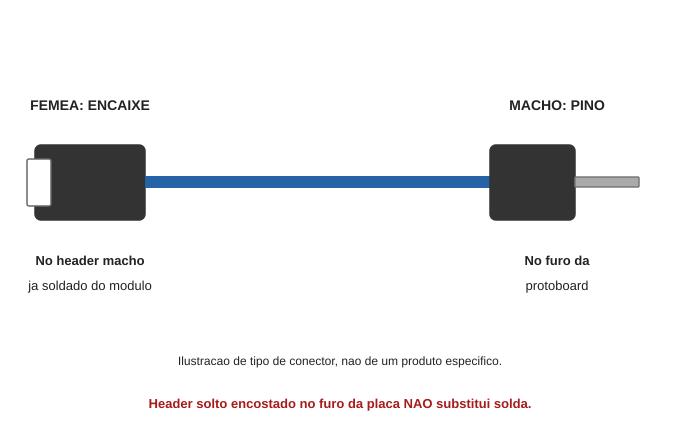

O cabo deste desenho tem uma ponta femea e outra macho. A ponta femea recebe o pino metalico do header; a ponta macho entra no furo da protoboard.

Pegar pelo conector plastico, nao puxar pelo fio. Encaixar sem forcar. Nao deixar parte metalica exposta encostar no pino vizinho.

Se o modulo nao tiver header macho ja soldado, obter a conexao correta antes. Nao prender um fio solto dentro de um furo metalizado da placa.

**Conferencia:** Identifique as duas pontas antes de usar o primeiro cabo.

## 10. Headers: pronto ou ainda sem solda?

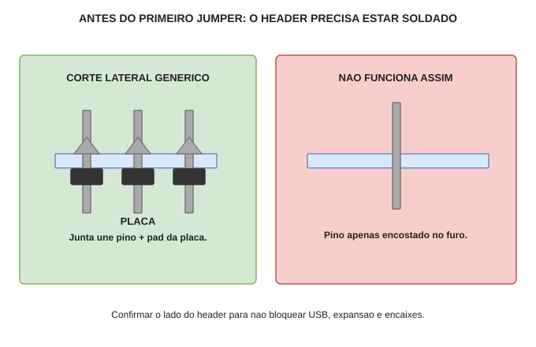

Olhe os contatos com boa luz, sem USB nem bateria. Um pino firme deve atravessar seu furo e ter uma junta de solda ligando o metal do pino ao pad (ilha metalica em volta do furo). Header e a barra de pinos. Se ha somente furos dourados, falta header.

1. Se os headers ja vieram soldados: verificar pinos retos e nenhuma ponte para o vizinho. Nao refazer uma solda boa so porque o desenho tem outra aparencia.
2. Se faltam headers: decidir entre ajuda presencial para preparar as pecas ou aprender primeiro na placa de treino.

Na XIAO base ha duas fileiras de sete contatos laterais. O OLED do anuncio tem quatro contatos. No AITRIP, a quantidade e o lado de insercao precisam ser conferidos na unidade.

Antes de soldar, verificar o lado de insercao SEM ENERGIA: depois de montado deve ser possivel encaixar o jumper sem bloquear USB, expansao ou componentes. O corte abaixo e generico, nao define qual lado soldar em cada placa.

**Conferencia:** Nao soldar com USB, bateria ou expansoes sensiveis ligadas; nao escolher o lado por este desenho.

## 11. Solda: primeiro treinar, depois preparar

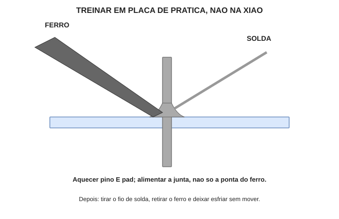

O adulto deve preparar bancada resistente ao calor, suporte do ferro, ventilacao e protecao ocular. Nao comer na bancada. Lavar as maos ao terminar. Manter a bateria longe da area quente.

Use uma placa de treino separada e header de sobra; nao comece pela XIAO. Usar solda para eletronica, nao fluxo acido de encanamento. Seguir temperatura e preparo indicados para o ferro e a liga utilizados; nao adivinhar uma temperatura universal.

1. Prender a placa de treino e o header para que nao se movam.
2. Limpar/estanhar a ponta conforme o manual do ferro.
3. Encostar a ponta no pino E no pad. Alimentar pouca solda na junta aquecida.
4. Retirar o fio de solda, depois o ferro. Deixar esfriar sem mover.
5. Inspecionar: junta molha pino e pad, sem bola solta ou ponte para outro pino.

Se nao fluir, houver plastico deformado ou precisar insistir aquecendo, parar e pedir ajuda. Nao cortar pinos de header que ainda serao usados pelos jumpers. Brilho sozinho nao comprova qualidade; algumas ligas ficam foscas.

**Conferencia:** So passar as pecas do robo a solda apos pratica satisfatoria e orientacao do lado correto.

## 12. Localizar os pinos na XIAO

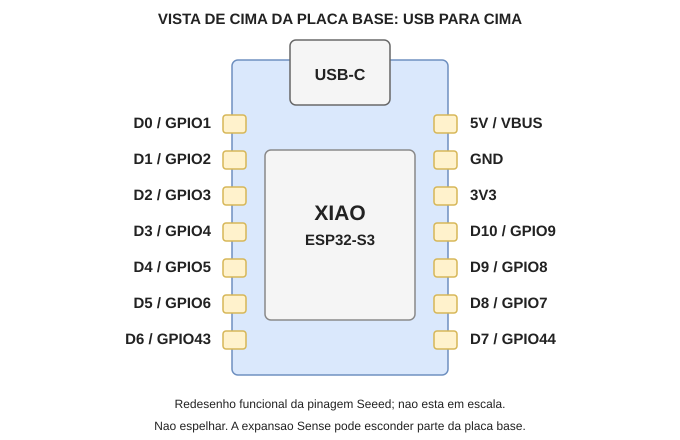

O desenho mostra a placa base pelo lado dos componentes, com USB em cima. Nao mostra o lado de baixo: olhar por baixo espelha esquerda/direita.

Compare com a pinagem oficial Seeed e a unidade recebida. Nao force nem retire a expansao Sense para encontrar um nome; use a documentacao e as inscricoes acessiveis.

ATENCAO: neste firmware o OLED usa D0 e D1. Embora tutoriais genericos chamem D4/D5 de SDA/SCL, NAO os use para o OLED aqui. D4 e audio LRC; D5 sera sinal TILT.

Se comprar outra placa, como ESP32-S3 Plus ou uma ESP32-CAM, este mapa nao se aplica.

**Conferencia:** D0 e GPIO1 sao nomes do mesmo pino; D1 e GPIO2 tambem.

## 13. Reconhecer o OLED comprado

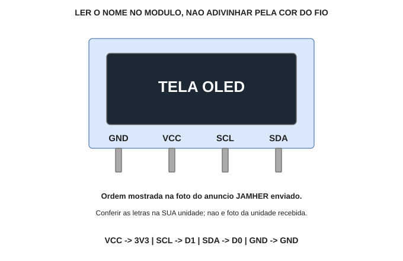

A tela e a regiao escura; os quatro contatos levam alimentacao e dados. Na imagem do anuncio fornecida, a ordem e GND, VCC, SCL, SDA. O desenho abaixo reproduz essa identificacao, nao uma foto da unidade que chegou.

1. Encontrar e ler as quatro inscricoes na placa real, com boa iluminacao.
2. Etiquetar GND, VCC, SCL e SDA nas pontas dos quatro cabos.
3. Se a ordem ou as letras forem diferentes, nao espelhar mentalmente nem usar a ordem por memoria. Confirmar os nomes antes de continuar.

VCC e o nome da entrada do display; neste projeto ela vai a 3V3. SCL leva clock e SDA leva dados. Nao e necessario decorar esses termos: seguir a ligacao nome a nome.

**Conferencia:** Nao usar display de seis/sete contatos SPI como substituto deste OLED I2C de quatro contatos.

## 14. Reconhecer o amplificador comprado

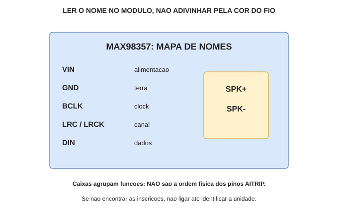

O MAX98357 e a placa que recebe dados digitais da XIAO e alimenta o falante. Localize VIN, GND, BCLK, LRC/LRCK e DIN. Ha tambem duas saidas para o falante.

O AITRIP nao tem necessariamente os pinos na ordem de fotos Adafruit. Este desenho e um mapa de NOMES e FUNCOES; nao e o desenho fisico da sua unidade.

1. Ler frente e verso do modulo sem energia.
2. Fazer etiquetas nos cinco cabos correspondentes.
3. Localizar SPK+ e SPK- sem confundi-los com VIN/GND.

Se houver SD, SD_MODE ou GAIN: nao conectar por adivinhacao. Uma unidade sem polarizacao apropriada pode ficar muda; isso exige esquema/documentacao do fornecedor.

Se nao for possivel identificar essas inscricoes, essa e uma parada obrigatoria. Nenhum desenho generico resolve com seguranca uma pinagem desconhecida.

**Conferencia:** Encontrou todos os nomes? Pode montar. Nao encontrou? Falta identificar a unidade real.

## 15. Preparar o layout escolhido

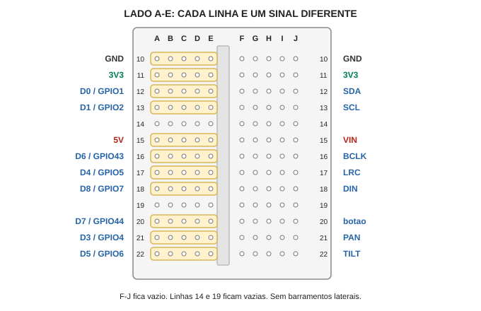

Nao encaixe XIAO, OLED ou MAX98357 nos furos: eles ficam apoiados e presos fora da protoboard. Os quadros dos proximos desenhos sao etiquetas dos pinos, NAO a ordem real do conector.

Escolher uma protoboard com A-J e pelo menos 22 linhas numeradas. So usar A-E. F-J e barramentos ficam vazios. Deixar linhas 14 e 19 vazias para separacao visual.

Em cada etapa: primeiro ligar o fio da XIAO ao furo A indicado; depois ligar o pino do modulo ao outro furo da MESMA linha. A tira interna faz a ponte entre eles. Nao inserir dois fios no mesmo furo.

Todos os passos de ligacao: USB fora, LiPo fora, fonte dos motores fora.

**Conferencia:** Confirme as inscricoes nas pecas. Nao use pino 'vizinho' como substituto.

## 16. Terra do OLED

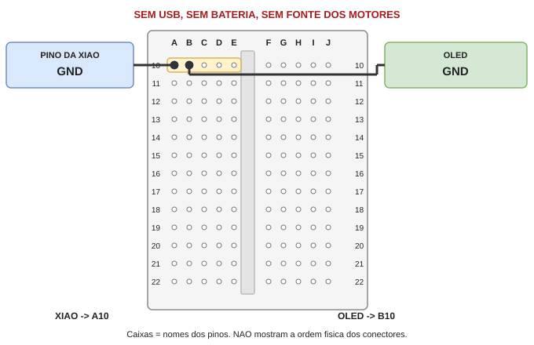

1. GND da XIAO -> a10. Usar um jumper.
2. GND do OLED -> b10. Usar outro jumper.
3. Ler o numero 10 nos dois furos. Eles devem estar no grupo A-E, nao do outro lado do vao.

Por que funciona: A10 e B10 sao ligados pela tira metalica interna. Nao e necessario colocar fio entre eles.

Se o pino nao estiver identificado, pare. Fios cruzados no desenho nao significam conexao; so as pontas entram nos furos marcados.

**Conferencia:** Conferido: GND da XIAO -> a10; GND do OLED -> b10. Continuar com tudo DESLIGADO.

## 17. Alimentacao do OLED

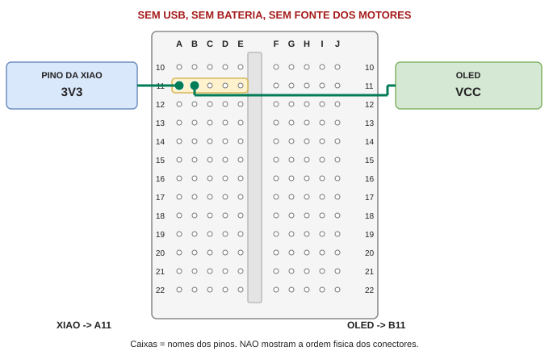

1. 3V3 da XIAO -> a11. Usar um jumper.
2. VCC do OLED -> b11. Usar outro jumper.
3. Ler o numero 11 nos dois furos. Eles devem estar no grupo A-E, nao do outro lado do vao.

Por que funciona: A11 e B11 sao ligados pela tira metalica interna. Nao e necessario colocar fio entre eles.

OLED VCC recebe 3V3, NAO 5V. Nao confundir o nome VCC do display com VIN do amplificador.

Se o pino nao estiver identificado, pare. Fios cruzados no desenho nao significam conexao; so as pontas entram nos furos marcados.

**Conferencia:** Conferido: 3V3 da XIAO -> a11; VCC do OLED -> b11. Continuar com tudo DESLIGADO.

## 18. Dados do OLED

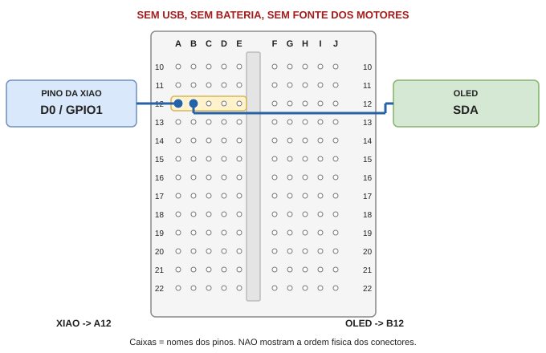

1. D0 / GPIO1 da XIAO -> a12. Usar um jumper.
2. SDA do OLED -> b12. Usar outro jumper.
3. Ler o numero 12 nos dois furos. Eles devem estar no grupo A-E, nao do outro lado do vao.

Por que funciona: A12 e B12 sao ligados pela tira metalica interna. Nao e necessario colocar fio entre eles.

Se o pino nao estiver identificado, pare. Fios cruzados no desenho nao significam conexao; so as pontas entram nos furos marcados.

**Conferencia:** Conferido: D0 / GPIO1 da XIAO -> a12; SDA do OLED -> b12. Continuar com tudo DESLIGADO.

## 19. Clock do OLED

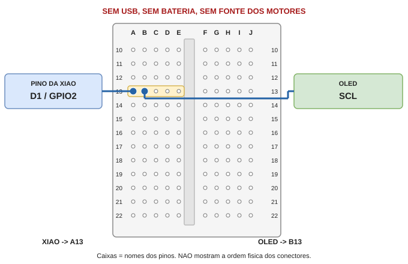

1. D1 / GPIO2 da XIAO -> a13. Usar um jumper.
2. SCL do OLED -> b13. Usar outro jumper.
3. Ler o numero 13 nos dois furos. Eles devem estar no grupo A-E, nao do outro lado do vao.

Por que funciona: A13 e B13 sao ligados pela tira metalica interna. Nao e necessario colocar fio entre eles.

Se o pino nao estiver identificado, pare. Fios cruzados no desenho nao significam conexao; so as pontas entram nos furos marcados.

**Conferencia:** Conferido: D1 / GPIO2 da XIAO -> a13; SCL do OLED -> b13. Continuar com tudo DESLIGADO.

## 20. Comparar: OLED com os oito fios

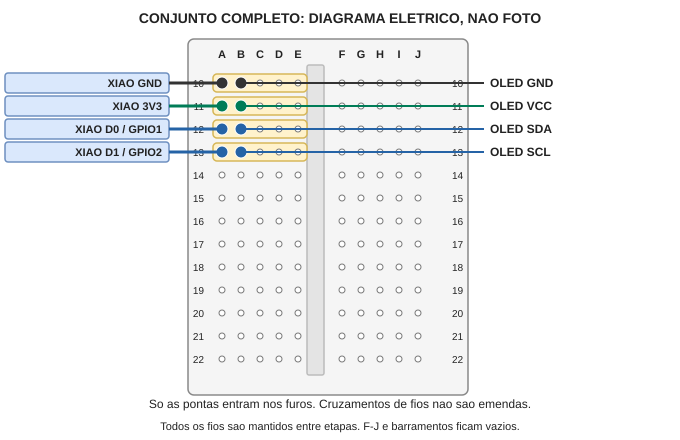

Nao tirar os fios de uma etapa anterior. Ao terminar o OLED existem oito jumpers: quatro saindo da XIAO e quatro saindo do display.

No desenho completo: cada linha une um pino da XIAO a um pino do OLED. Nao ha conexao entre linhas diferentes. Fios que passam por cima de outros furos nao entram neles.

Confira A10/B10, A11/B11, A12/B12 e A13/B13. A imagem mostra ligacoes eletricas, nao as posicoes fisicas dos modulos. Use a pagina de pinagem da XIAO e as letras do OLED para achar as pontas reais.

Ainda nao conectar USB: falta integrar audio e revisar o nucleo.

**Conferencia:** Oito jumpers no total; nenhuma ligacao do display vai para 5V.

## 21. Terra do amplificador

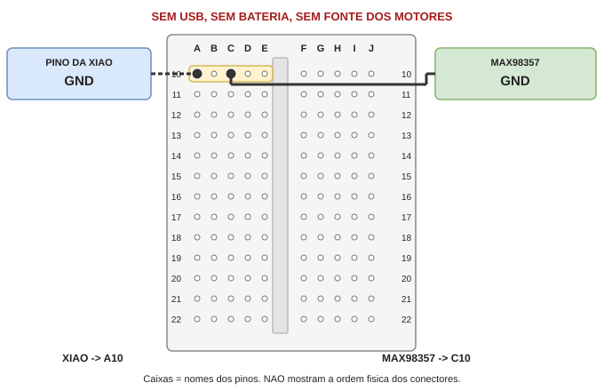

1. Manter GND da XIAO -> a10. Esse fio ja existe; NAO adicionar outro no mesmo furo.
2. GND do MAX98357 -> c10. Usar outro jumper.
3. Ler o numero 10 nos dois furos. Eles devem estar no grupo A-E, nao do outro lado do vao.

Por que funciona: A10 e C10 sao ligados pela tira metalica interna. Nao e necessario colocar fio entre eles.

Agora A10 = GND da XIAO, B10 = GND do OLED, C10 = GND do amplificador. Sao tres furos diferentes.

Se o pino nao estiver identificado, pare. Fios cruzados no desenho nao significam conexao; so as pontas entram nos furos marcados.

**Conferencia:** Conferido: Manter GND da XIAO -> a10; GND do MAX98357 -> c10. Continuar com tudo DESLIGADO.

## 22. Alimentacao do amplificador

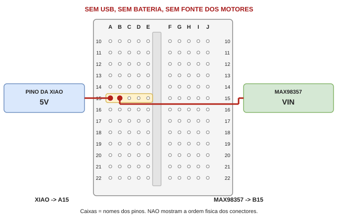

1. 5V da XIAO -> a15. Usar um jumper.
2. VIN do MAX98357 -> b15. Usar outro jumper.
3. Ler o numero 15 nos dois furos. Eles devem estar no grupo A-E, nao do outro lado do vao.

Por que funciona: A15 e B15 sao ligados pela tira metalica interna. Nao e necessario colocar fio entre eles.

O 5V vem do pino da XIAO quando alimentada por USB. NAO conectar fonte externa nessa linha.

Se o pino nao estiver identificado, pare. Fios cruzados no desenho nao significam conexao; so as pontas entram nos furos marcados.

**Conferencia:** Conferido: 5V da XIAO -> a15; VIN do MAX98357 -> b15. Continuar com tudo DESLIGADO.

## 23. Clock de audio

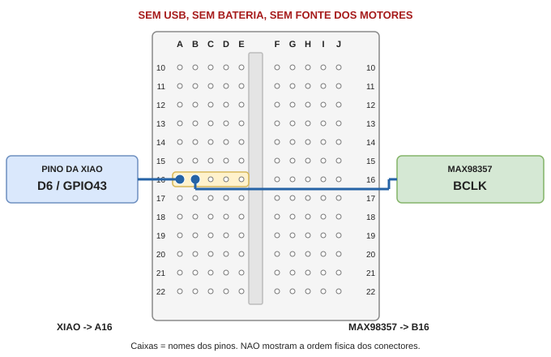

1. D6 / GPIO43 da XIAO -> a16. Usar um jumper.
2. BCLK do MAX98357 -> b16. Usar outro jumper.
3. Ler o numero 16 nos dois furos. Eles devem estar no grupo A-E, nao do outro lado do vao.

Por que funciona: A16 e B16 sao ligados pela tira metalica interna. Nao e necessario colocar fio entre eles.

Se o pino nao estiver identificado, pare. Fios cruzados no desenho nao significam conexao; so as pontas entram nos furos marcados.

**Conferencia:** Conferido: D6 / GPIO43 da XIAO -> a16; BCLK do MAX98357 -> b16. Continuar com tudo DESLIGADO.

## 24. Canal de audio

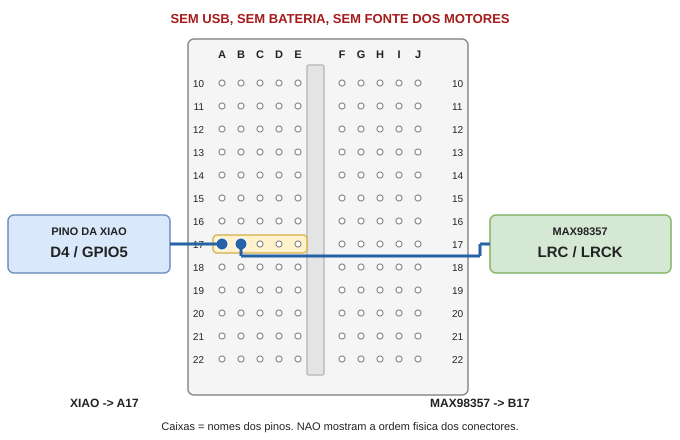

1. D4 / GPIO5 da XIAO -> a17. Usar um jumper.
2. LRC / LRCK do MAX98357 -> b17. Usar outro jumper.
3. Ler o numero 17 nos dois furos. Eles devem estar no grupo A-E, nao do outro lado do vao.

Por que funciona: A17 e B17 sao ligados pela tira metalica interna. Nao e necessario colocar fio entre eles.

Se o pino nao estiver identificado, pare. Fios cruzados no desenho nao significam conexao; so as pontas entram nos furos marcados.

**Conferencia:** Conferido: D4 / GPIO5 da XIAO -> a17; LRC / LRCK do MAX98357 -> b17. Continuar com tudo DESLIGADO.

## 25. Dados de audio

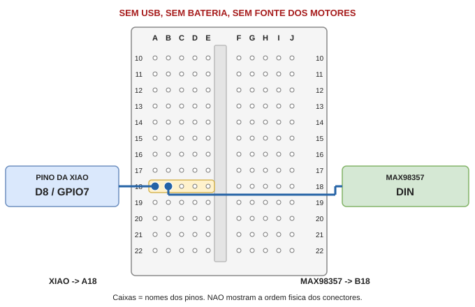

1. D8 / GPIO7 da XIAO -> a18. Usar um jumper.
2. DIN do MAX98357 -> b18. Usar outro jumper.
3. Ler o numero 18 nos dois furos. Eles devem estar no grupo A-E, nao do outro lado do vao.

Por que funciona: A18 e B18 sao ligados pela tira metalica interna. Nao e necessario colocar fio entre eles.

Se o pino nao estiver identificado, pare. Fios cruzados no desenho nao significam conexao; so as pontas entram nos furos marcados.

**Conferencia:** Conferido: D8 / GPIO7 da XIAO -> a18; DIN do MAX98357 -> b18. Continuar com tudo DESLIGADO.

## 26. Ligar um unico alto-falante

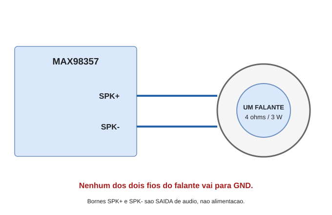

O falante NAO usa as linhas GND, 3V3 ou 5V da protoboard. Ele recebe dois fios diretamente das saidas do amplificador.

1. Preparar dois fios flexiveis para eletronica. Desencapar apenas o necessario para a conexao, com descascador adequado, sem cortar os filamentos. Nao usar chama nem morder a isolacao.
2. Se o falante vier com abas sem fios: soldar um fio por aba, somente apos a pratica de solda. Nao encostar o ferro no cone ou na isolacao. Se nao souber prender e soldar essas abas, obter ajuda presencial.
3. Ligar um terminal do falante a SPK+ do MAX98357; o outro terminal a SPK-. Se o falante tiver + marcado, usar esse terminal em SPK+.
4. Se houver borne de parafuso no modulo: prender apenas o trecho desencapado, sem filamentos para fora. Puxar suavemente para conferir. Se houver apenas furos, identificar a conexao/solda apropriada; fio solto encostado nao serve.

Nao unir os dois terminais, nao ligar SPK- ao GND e nao colocar dois falantes em paralelo. Se as inscricoes da sua unidade forem outras, confirmar antes de conectar.

**Conferencia:** So um falante. Nenhum fio do falante vai ao GND.

## 27. Conjunto completo: todos os 17 jumpers

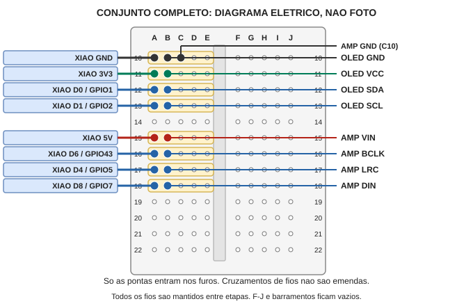

Agora ha oito cabos da XIAO para a protoboard e nove dos modulos para ela: total 17. O falante usa dois fios adicionais diretos, mostrados na pagina propria.

GND e compartilhado em tres furos diferentes: A10 XIAO; B10 OLED; C10 amplificador. Nao colocar dois conectores no mesmo furo.

F-J fica vazio. Linhas 14 e 19 ficam vazias. A20/A21/A22 ainda nao recebem fios nesta montagem inicial.

A linha preta de AMP GND usa C10. Os outros destinos usam B na mesma linha do pino da XIAO. Cruzamentos de linhas no desenho nao sao emendas.

**Conferencia:** Comparar ponta por ponta, nao apenas se o conjunto tem 'cores parecidas'.

## 28. Conferir todos os fios antes do USB


Leia em voz alta e siga cada fio com o dedo, sem energia:

A10 XIAO GND; B10 OLED GND; C10 MAX98357 GND.
A11 XIAO 3V3; B11 OLED VCC.
A12 XIAO D0/GPIO1; B12 OLED SDA.
A13 XIAO D1/GPIO2; B13 OLED SCL.
A15 XIAO 5V; B15 MAX98357 VIN.
A16 XIAO D6/GPIO43; B16 MAX98357 BCLK.
A17 XIAO D4/GPIO5; B17 MAX98357 LRC/LRCK.
A18 XIAO D8/GPIO7; B18 MAX98357 DIN.

Nao alterar SD/GAIN do AITRIP por adivinhacao. Manter a configuracao de fabrica. A camera/microfone usam a expansao Sense; nao recebem jumpers desta tabela.

Fotografar de cima com as inscricoes legiveis. Se nao souber confirmar uma ligacao, nao energizar para experimentar. Uma revisao remota da foto tambem nao substitui medicao.

**Conferencia:** Sem servos, sem LiPo, sem microSD. Sem pontes de 3V3/5V para GND.

## 29. Windows 1: baixar e extrair o pacote

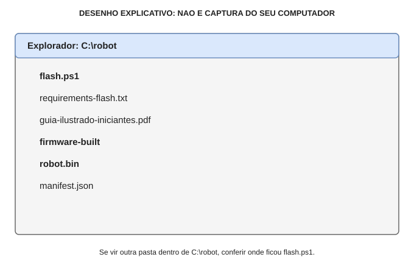

1. No navegador, abrir a release v0.1.2:
https://github.com/ricmmartins/family-ai-robot/releases
2. Na lista Assets dessa release, baixar robo-de-mesa-completo.zip. NAO escolher 'Source code (zip)': ele nao inclui o binario robot.bin.
3. No Explorador de Arquivos, ir a Downloads. Clicar com botao direito no ZIP e usar 'Extrair Tudo' / 'Extract All'. Nao executar arquivos dentro da janela do ZIP.
4. Escolher uma pasta nova, curta e permitida, por exemplo C:\robot. Se ela ja tiver arquivos, escolher outra pasta vazia e adaptar todos os comandos do guia.

Ao terminar, flash.ps1 e a pasta firmware-built devem estar diretamente na pasta de trabalho. Dentro de firmware-built devem existir robot.bin e manifest.json.

Se so existir outra subpasta, abrir essa subpasta: esse e o caminho a usar no PowerShell. Nao misturar arquivos de releases diferentes.

**Conferencia:** Conferir os arquivos pelo nome. Nao precisa instalar ESP-IDF para gravar este binario.

## 30. Windows 2: abrir PowerShell e Python

Este roteiro usa Windows com permissao para instalar aplicativos. Em computador escolar/gerenciado, pedir autorizacao; nao contornar bloqueios.

1. Instalar o Python install manager pelo site oficial ou Microsoft Store, conforme as instrucoes:
https://docs.python.org/3/using/windows.html
2. Fechar terminais antigos. Abrir Iniciar, digitar PowerShell e abrir uma janela comum, sem 'Executar como administrador'.

3. Digitar cada comando abaixo e pressionar Enter. Esperar o comando acabar e aparecer de novo a linha iniciada por PS. Nao digitar o PS: ele e o prompt, nao parte do comando.


```powershell
pymanager install 3.12
py -V:3.12 --version
```


Resultado esperado do segundo comando: Python 3.12.x, com x variavel. Isso instala/seleciona uma versao compativel sem remover outros Pythons do computador.

Se pymanager nao for reconhecido, confirmar que instalou o install manager, nao apenas um Python antigo; reabrir o terminal e consultar a secao Troubleshooting da documentacao oficial. Se py nao localizar 3.12, nao trocar de versao por tentativa: resolver a instalacao primeiro.

**Conferencia:** Antes de continuar, py -V:3.12 --version deve funcionar. Nenhuma placa precisa estar conectada.

## 31. Windows 3: preparar as ferramentas

Manter a janela PowerShell aberta. Digitar uma linha por vez. Se usou outra pasta, substituir C:\robot pelo caminho real entre aspas.


```powershell
Set-Location 'C:\robot'
Test-Path .\flash.ps1
Test-Path .\firmware-built\robot.bin
```


Os dois Test-Path devem responder True. False significa pasta/pacote errado, nao defeito da placa.


```powershell
py -V:3.12 -m venv .venv
.\.venv\Scripts\python.exe -m pip install -r requirements-flash.txt
.\.venv\Scripts\python.exe -m esptool version
```


O ultimo comando deve informar esptool 5.6.0. A pasta .venv guarda as ferramentas somente aqui. Nao e preciso ativar ambiente virtual, alterar PATH ou mudar a politica global de scripts.

Se qualquer linha falhar: parar nessa linha. Guardar o texto do erro. Nao copiar uma sequencia inteira presumindo que os passos anteriores deram certo.

Erro de rede ao instalar: conferir internet/proxy autorizado. Falta de python.exe dentro de .venv indica que a criacao do ambiente nao terminou.

**Conferencia:** True, True e esptool 5.6.0. Instalar a ferramenta ainda nao testa a placa.

## 32. Windows 4: descobrir a porta COM

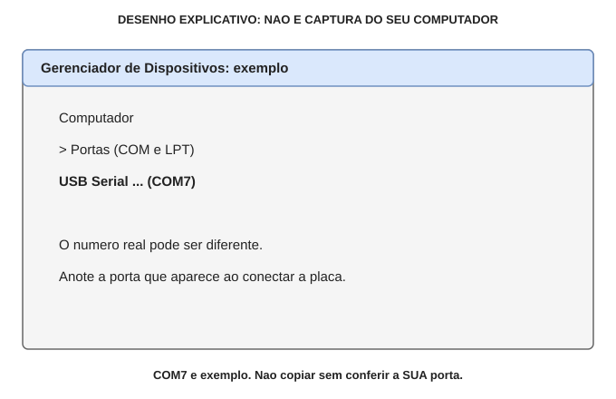

Primeiro concluir a revisao eletrica; fonte dos servos e LiPo continuam desconectadas.

1. Com USB retirado, clicar com botao direito em Iniciar e abrir Gerenciador de Dispositivos / Device Manager. Observar Portas / Ports (COM & LPT), se existir.
2. Conectar a XIAO com cabo USB de DADOS. Observar a porta que apareceu. Ela pode ter outro nome e numero, nao necessariamente COM7.
3. Retirar USB e verificar se essa porta desaparece. Reconectar e confirmar novamente.

Anotar: MINHA PORTA = COM____. Usar esse valor no lugar de COM7 nas proximas paginas.

Se nada aparecer: testar cabo de dados conhecido e outra porta USB. Se persistir, usar BOOT como na pagina seguinte. Nao baixar drivers de sites aleatorios nem selecionar outra porta que ja existia.

**Conferencia:** COM7 no desenho e EXEMPLO. Se nao identificar a sua porta, nao tentar gravar.

## 33. Windows 5: BOOT e gravacao

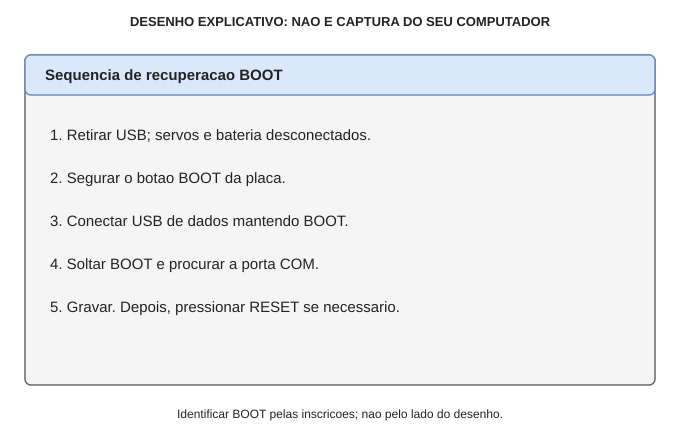

Se a porta normal ja estiver identificada, tentar o comando de gravacao abaixo. Se a conexao falhar, entrar em BOOT conforme o desenho e identificar a porta novamente: ela pode mudar no modo de gravacao.

Trocar COM7 pela porta real. Fechar monitores seriais antes de gravar.

```powershell
powershell -ExecutionPolicy Bypass -File .\flash.ps1 -Port COM7
```


Isso aplica a politica somente ao processo do script, nao permanentemente ao computador. Nao usar para contornar politicas de um equipamento gerenciado.

O script verifica identidade e SHA256, depois grava a imagem completa em 0x0. Nao retirar USB durante a transferencia. Ao terminar deve aparecer 'Flash transfer complete'. Se falhar: nao declarar gravado; resolver o erro.

BOOT e o botao para modo de download e conversa. RESET reinicia a placa. Identificar pelas inscricoes/documentacao da unidade, nao pelo lado do desenho.

**Conferencia:** Mensagem final confirma transferencia, nao audio, camera, alimentacao ou ativacao na nuvem.

## 34. Primeiro teste energizado

Este teste exige nova XIAO Sense com expansao corretamente encaixada e a montagem eletrica ja conferida. Se isso ainda nao foi possivel, PARE ANTES DO USB.

1. Manter fonte dos motores e LiPo desconectadas.
2. Usar cabo USB de dados e fonte/porta adequada. Comecar com audio baixo; uma porta USB fraca pode nao sustentar os picos do conjunto.
3. Abrir o log no PowerShell e pressionar RESET:


```powershell
.\.venv\Scripts\python.exe -m serial.tools.miniterm `
  --rts 0 --dtr 0 COM7 115200
```


Usar a porta real. O acento grave ` ao fim da primeira linha continua o comando na segunda.

4. Procurar 'SH1106 initialized' e 'Camera ready'. O display deve mostrar interface sem deslocamento ou corte. Fechar monitor com Ctrl+].

Se houver calor anormal, cheiro, fumaca, erro fatal ou reinicializacoes: desconectar USB. Nao mexer em fios com energia nem insistir ligando repetidamente.

Nao ligar so o OLED e interpretar falha da camera como defeito do display. O firmware atual exige a expansao da camera e verifica seu sensor na inicializacao.

Falta de audio deve ser investigada pelos pinos e pela documentacao do modulo AITRIP. Nao improvisar pontes SD/GAIN.

**Conferencia:** Avancar so com display legivel, camera inicializada e sem resets/aquecimento anormal.

## 35. Nuvem 1: tela de entrada real


Pagina publica conferida em 28/10/2026, sem entrar em nenhuma conta. O recorte nesta pagina mostra a entrada da Console, nao a tela de pareamento do robo.

1. Abrir https://xiaozhi.me/ e clicar Console.
2. O site direciona para login. Na tela observada ha SMS Code, Username & Password e Sign in with Google. Escolher um metodo permitido para sua conta; ler termos/privacidade antes de aceitar.

Nao escolher +86 por copia do exemplo. Nao compartilhar telefone, senha, SMS, token ou codigo de dispositivo. Nenhuma conta foi criada ou autorizada por nos para produzir este manual.

Ainda NAO foi inspecionada a area autenticada; os nomes dos menus de pareamento e configuracao posteriores nao foram confirmados. Se a interface nao orientar a vinculacao, parar e consultar ajuda do servico; nao instalar firmware de outra placa.

**Conferencia:** Captura real de entrada anonima; ativacao do nosso dispositivo continua nao comprovada.

## 36. Wi-Fi, voz e foto: testes separados

Usar primeiro a rede domestica 2,4 GHz autorizada. Seguir o nome da rede e portal mostrados no OLED/log; nao assumir um IP fixo.

No primeiro provisionamento, usar as instrucoes mostradas no OLED/log para cadastrar Wi-Fi. No portal autenticado, vincular o dispositivo conforme o fluxo do servico, caso seja oferecido para esta placa. Nao ha aqui nomes de botoes autenticados confirmados. Se nao houver fluxo compativel, parar nesta etapa.

Configurar idioma da IA e voz para ingles quando essas opcoes estiverem disponiveis. A interface inglesa do firmware NAO configura a voz da nuvem. Clique curto no BOOT alterna a conversa conforme o estado; nao ha wake word nesta primeira versao.

Teste voz: 'Hello. Please answer in English.' Fazer dez interacoes curtas, confirmando que ela ouve e responde sem reset.

Teste foto: mostrar um objeto simples e pedir 'Take a photo and describe the object in front of you.' Nao mostrar rostos, documentos ou telas pessoais.

Visao precisa de configuracao enviada pelo backend. Voz funcionando NAO comprova visao. Se falhar, guardar erro do log; nao trocar fios ao acaso.

Os testes sao criterios de aceitacao A EXECUTAR. Nao foram feitos remotamente nestas pecas.

**Conferencia:** Registrar separadamente: ativacao; voz; fotografia; descricao. Nao marcar tudo como aprovado de uma vez.

## 37. Se nao funcionar: diagnostico em ordem

CALOR, CHEIRO OU FUMACA: retirar USB imediatamente, sem tocar partes quentes. Nao insistir, recolocar fios ou energizar para 'ver se passou'.

SEM PORTA COM: confirmar cabo de dados e porta USB; tentar BOOT; identificar novamente a porta. Porta ocupada: fechar monitor serial e outros aplicativos que a usam.

ERRO DE HASH/IDENTIDADE: nao ignorar a verificacao. Baixar novamente o ZIP correto da mesma release. Falta robot.bin: provavelmente baixou Source code, nao o pacote dos Assets.

SEM DISPLAY: desligar USB; conferir VCC->3V3, GND, SDA->D0 e SCL->D1. Pinos D4/D5 de tutoriais I2C genericos NAO sao estes pinos. Nao tentar 5V para corrigir tela apagada.

CAMERA FAIL: confirmar placa Sense e expansao instalada conforme manual Seeed. Identificar sensor real antes de mexer em cabo flat; nao desmontar com energia.

OUVE MAS NAO FALA: revisar VIN/GND, D6/BCLK, D4/LRC, D8/DIN e falante SPK+/SPK-. Conferir documentacao AITRIP para SD/GAIN. Nao aterrar uma saida do falante.

FALA MAS NAO ENXERGA: verificar log e configuracao de visao no backend. Isso nao comprova defeito de fio da camera.

RESETS AO FALAR: parar e investigar alimentacao/cabos; nao conectar motores para experimentar.

**Conferencia:** Registrar primeiro erro e etapa. Nao trocar varios fios de uma vez; sempre desligar antes de mexer.

## 38. Botao de cabeca: preparacao opcional

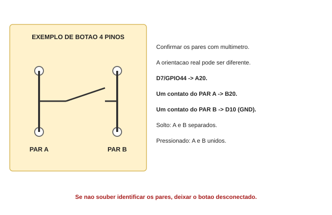

Deixar motores e suas fontes desconectados. Se o botao tiver quatro pernas, primeiro identificar os dois pares com continuidade, fora do circuito e sem energia.

Um par ja tem continuidade sem pressionar. Os dois pares so devem se unir ao pressionar. O desenho mostra uma possibilidade, NAO a orientacao garantida da sua peca.

1. D7/GPIO44 da XIAO -> A20.
2. Um contato do primeiro par -> B20.
3. Um contato do outro par -> D10, GND ja existente.

Manter o botao fora da protoboard se seus pinos nao couberem sem curto. Nao tentar encaixa-lo conforme o desenho sem confirmar os pares. O codigo usa pull-up interno; nao adicionar resistor ou ligacao a 5V por conta propria.

**Conferencia:** Sem identificar os pares com certeza, nao instalar o botao. Nao habilitar motores agora.

## 39. Motores: entender antes de montar

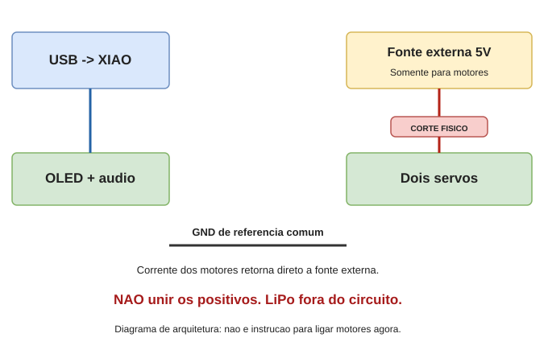

Esta pagina explica a separacao de alimentacao. Nao e desenho de montagem em furos para os servos, pois os conectores, fonte e corte fisico reais ainda precisam ser identificados.

A fonte externa alimenta os dois servos; seus retornos vao direto a essa fonte. Um fio dedicado de referencia une GND da fonte a GND da XIAO. Nunca fazer corrente dos motores passar pela XIAO ou pela linha GND fina da protoboard.

Sinais previstos: PAN em D3/GPIO4; TILT em D5/GPIO6. A aceitacao de sinal 3,3V precisa ser verificada nos servos reais.

Nao ligar o positivo da fonte externa a A15 nem ao 5V da XIAO. Nao colocar capacitor invertido nem conectar a LiPo. A etapa seguinte exige fonte regulada adequada, bornes/fios de potencia, interruptor de corte e conferencia de polaridade.

**Conferencia:** PARADA DOS MOTORES: fonte, conectores e mecanica ainda exigem identificacao e revisao.

## 40. Montagem fisica e pontos de parada

No primeiro corpo, somente o OLED fica na cabeca movel. Camera, XIAO, amplificador e falante ficam na base fixa. Portanto virar a cabeca NAO gira a camera.

Planejar suporte leve para OLED, base estavel e folga dos quatro fios. Nao colar o OLED no pan-tilt antes de centralizar/testar os servos sem carga. Nao forcar os eixos nem ajustar bracos com energia.

Este manual entrega diagramas de protoboard e ligacoes centrais. Nao entrega prova de funcionamento fisico nem desenho fiel dos conectores ainda nao fotografados.

PARE se: nao ha headers soldados; faltam jumpers corretos; nao sabe identificar pino; protoboard nao corresponde ao mapa; teste de continuidade diverge; polaridade nao e clara; fonte entra em protecao; ha resets, aquecimento ou mecanica presa.

Para fechar a montagem exata: fotos de cima e de lado das pecas desligadas, inscricoes legiveis, modelo da camera/servos e fonte dos motores. Nao precisa enviar comprovantes, endereco ou fotos de pessoas.

Proximo objetivo verificavel: ligar o nucleo OLED/audio/camera sem motores e registrar os resultados individuais da pagina de testes.

**Conferencia:** Nao chamar o robo de funcional ate testar fisicamente cada subsistema e a nuvem.

## 41. Corpo fixo e cabeca movel

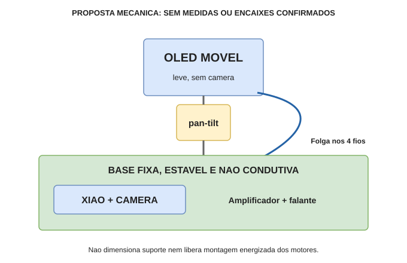

O desenho mostra somente uma proposta de distribuicao das pecas, nao um molde para cortar nem o encaixe exato do pan-tilt recebido.

Fixar placas em suporte nao condutivo; proteger a parte inferior e aliviar a tracao dos cabos na base. Nao deixar pinos expostos encostarem em metal. Manter lente, microfone e antena desobstruidos.

Reservar folga nos quatro fios do OLED. Fios nao podem esticar, prender no eixo ou servir de sustentacao. Nao fazer teste de movimento antes de revisar fonte/servos e centralizar sem carga.

Para a primeira prova de voz/visao, deixar todas as pecas fixas e os motores desconectados. Nao e preciso montar a cabeca para testar esse nucleo.

**Conferencia:** Camera continua fixa. Movimento do OLED nao aponta a camera para outra direcao.

## 42. Ficha de ensaio: preencher, nao presumir

DATA: ____________   Placa/camera identificadas: ___________________

Marcar cada item como NAO FEITO, PASSOU ou FALHOU; anotar evidencia e erro.

Protoboard vazia: continuidade igual ao mapa: _______________________
Headers e 17 cabos revisados sem energia: __________________________
Firmware: transferencia terminou sem erro: _________________________
OLED: texto legivel, sem corte/deslocamento: ________________________
Camera: log Camera ready e sem erro fatal: _________________________
Conta: dispositivo vinculado na nuvem: _____________________________
Microfone + voz: dez conversas curtas sem reset: ____________________
Foto: envio realizado; descricao compativel com objeto: ______________
Alimentacao: sem resets, cheiro ou calor anormal: ___________________
Motores: NAO ENSAIADOS enquanto a etapa estiver bloqueada.

Se precisar de revisao: foto geral de cima e fotos de frente/verso dos modulos, tudo desligado; nomes dos pinos legiveis; primeiro erro do log, sem credenciais. Nao incluir rostos, documentos pessoais ou recibos.

Esta ficha separa o que foi observado do que ainda e uma proposta. Nem passar todos os itens substitui ensaios de corrente/temperatura ou aprova uso escolar.

**Conferencia:** Nao preencher PASSOU por ter lido o guia. Precisa ter observado o resultado na montagem.

## 43. Fontes e significado das cores

Desenhos originais gerados para este projeto em 28/10/2026. Sao diagramas de ligacao, nao fotos nem certificacao de seguranca.

Preto/cinza escuro: GND. Verde: 3V3. Vermelho: 5V. Azul: sinais. As cores dos jumpers reais podem diferir; o NOME e o DESTINO identificam o fio.

Protoboard: grupos de cinco, vao central e barramentos:
https://learn.sparkfun.com/tutorials/how-to-use-a-breadboard/all

XIAO ESP32-S3 Sense, identificacao/pinagem oficial:
https://wiki.seeedstudio.com/xiao_esp32s3_getting_started/

Saida do MAX98357, referencia funcional; conferir AITRIP real:
https://learn.adafruit.com/adafruit-max98357-i2s-class-d-mono-amp/pinouts

Pratica e preparo de solda:
https://learn.adafruit.com/adafruit-guide-excellent-soldering/preparation
https://learn.adafruit.com/adafruit-guide-excellent-soldering/making-a-good-solder-joint

Instalacao Python no Windows:
https://docs.python.org/3/using/windows.html

Software e codigo exato dos pinos do projeto:
https://github.com/ricmmartins/family-ai-robot

Base de software:
https://github.com/78/xiaozhi-esp32

Comprovado: compilacao/link do firmware publicado. Nao comprovado: montagem, funcionamento nas suas pecas, ativacao em nuvem e uso escolar.
